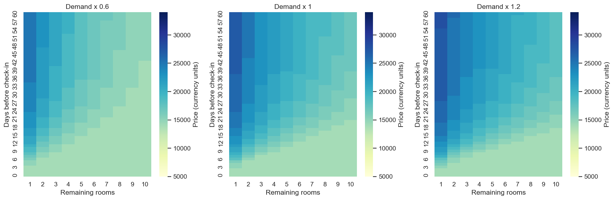
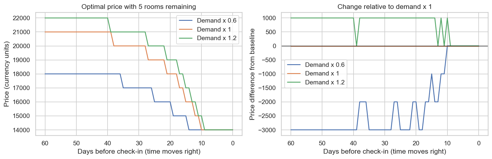
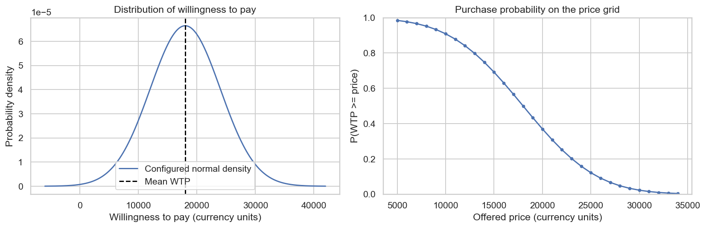
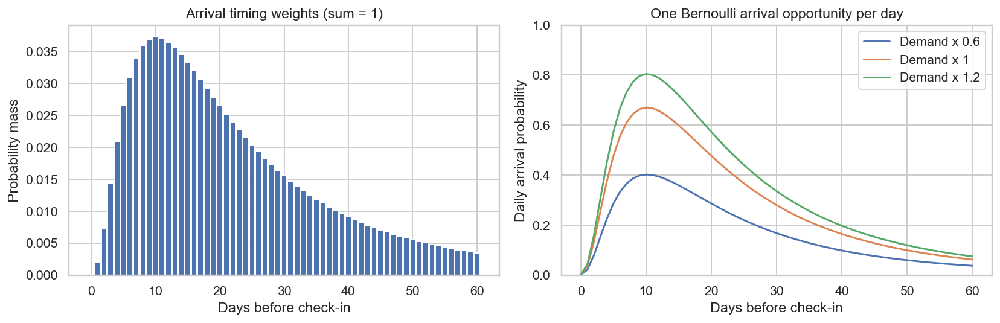

# Hotel pricing workshop: executed results

The three root notebooks contain outputs of this run. Inputs are invented and
pricing is deterministic: each accepted sale permanently consumes one room.
There is no simulation sample size.

- [Scenario](scenario.yaml): input assumptions.
- [Price and expected-revenue tables](result/price_tables.csv): 2,013 states across
  demand multipliers 0.6, 1.0 and 1.2, lead times 0–60 and room counts 0–10.
- [Execution report](execution-report.json): all three notebooks completed.
- [Validation](validation.json): checks and source commit.
- `model/`: three generated inputs and the calculated price/value tables.

## Compare optimal prices

## Understand the inputs

To reproduce, create a fresh workspace from `scenario.yaml` using Notebook 01 or
the preparation script, then execute Notebooks 02 and 03 inside that workspace.
Expected revenues are kept at full precision during optimisation. Infinite prices
in zero-room states mean sales are closed, and those states are omitted from the
heatmap colour scale.
